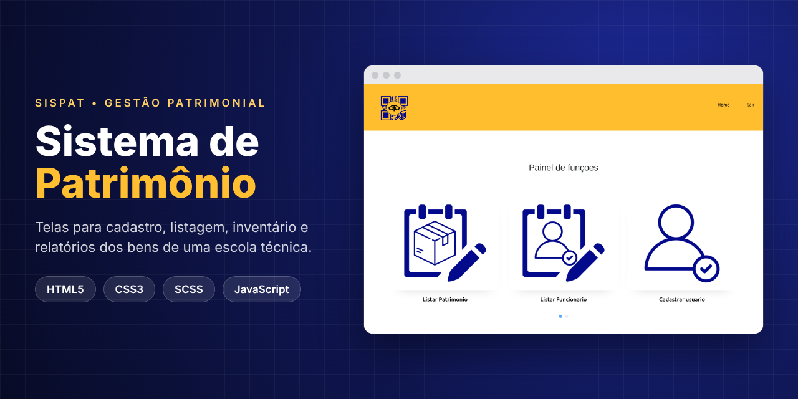
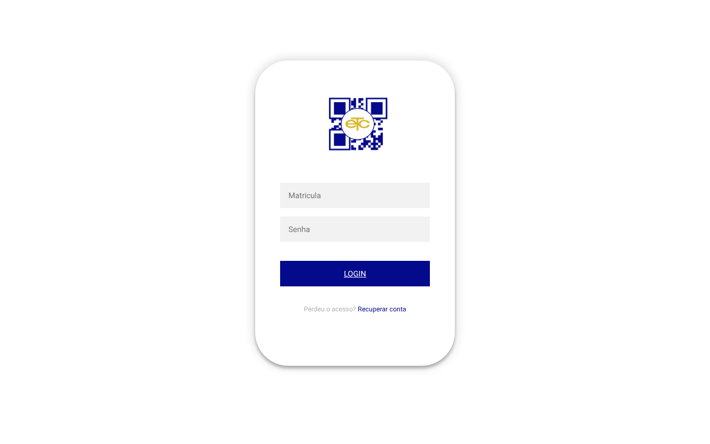
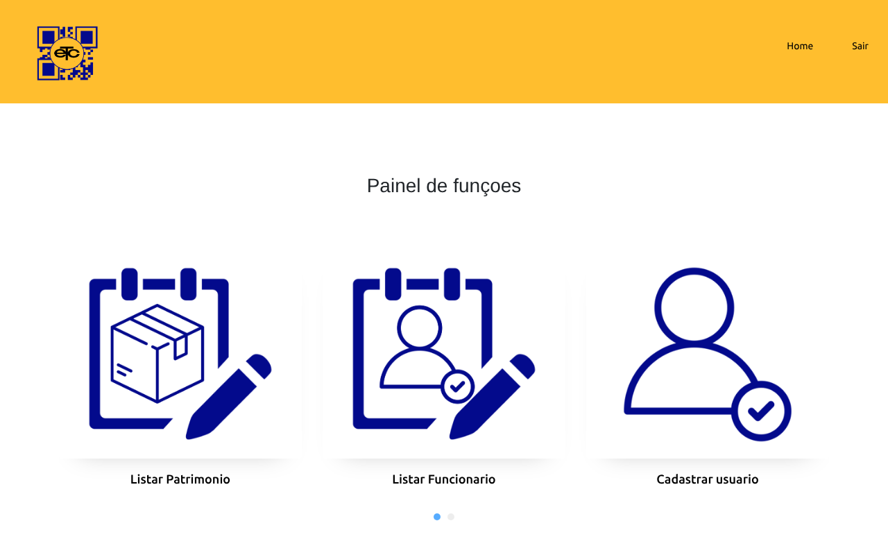
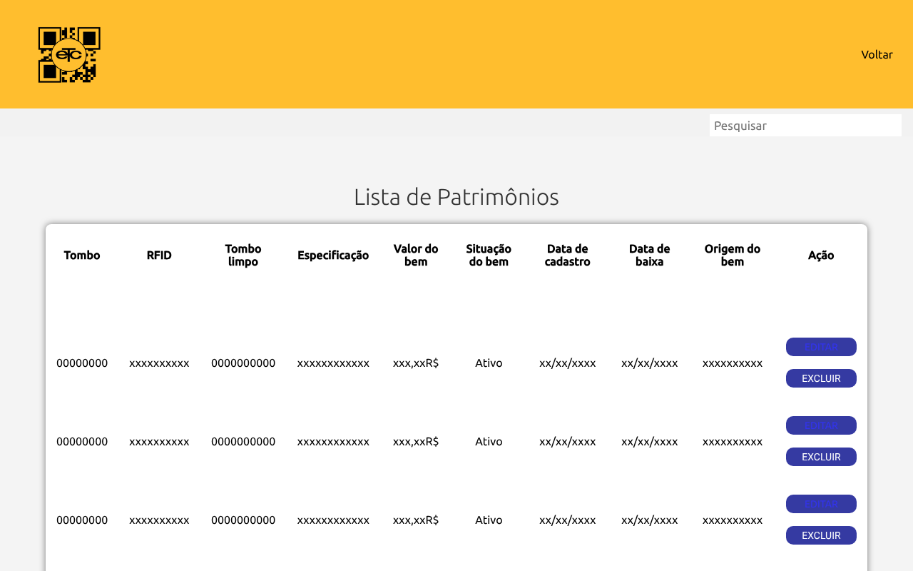
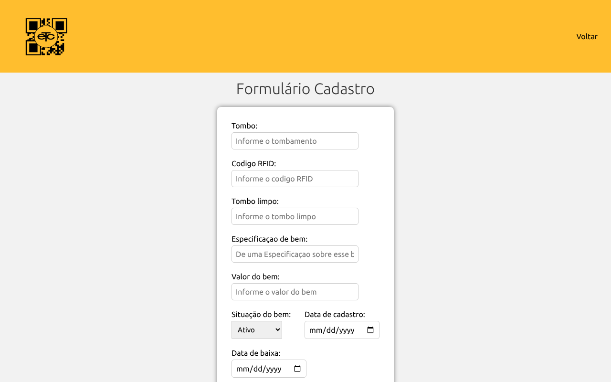
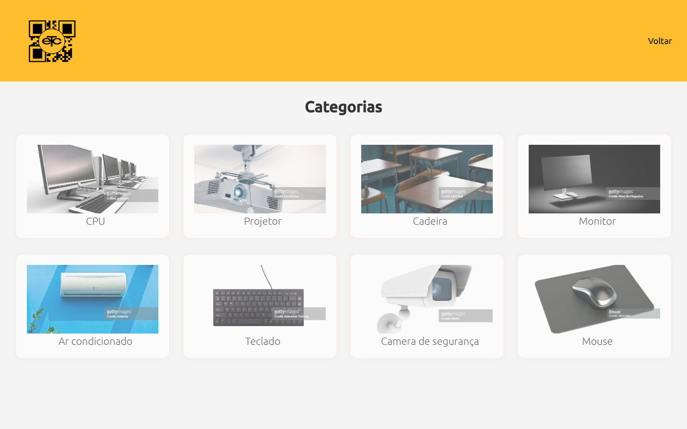
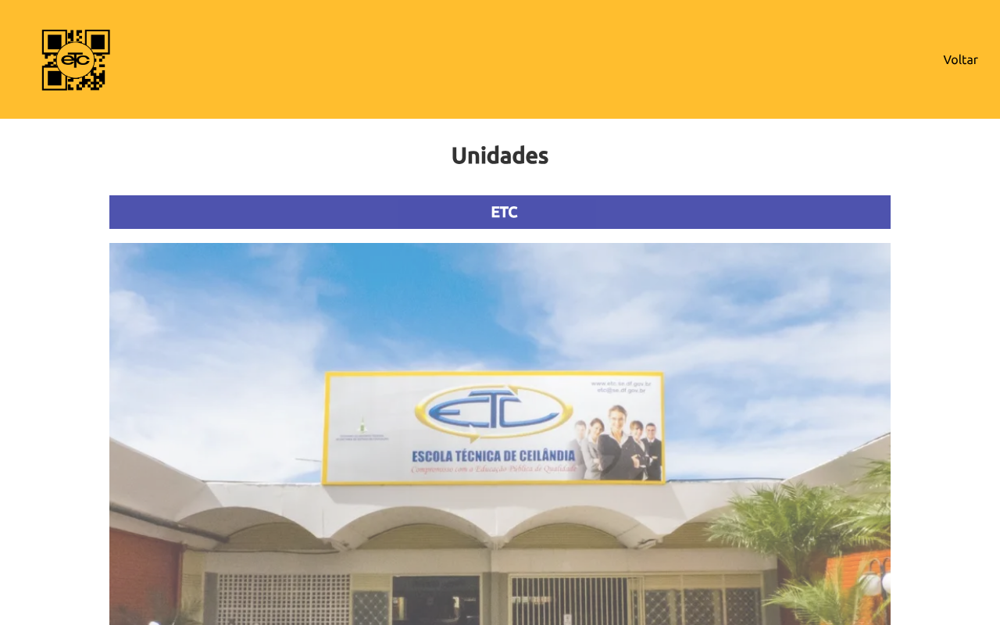
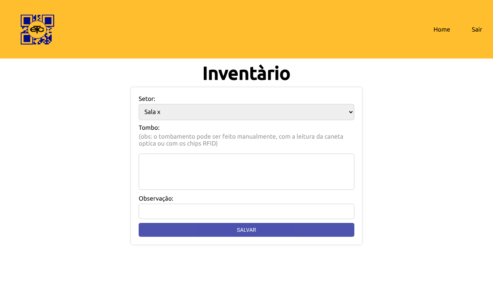
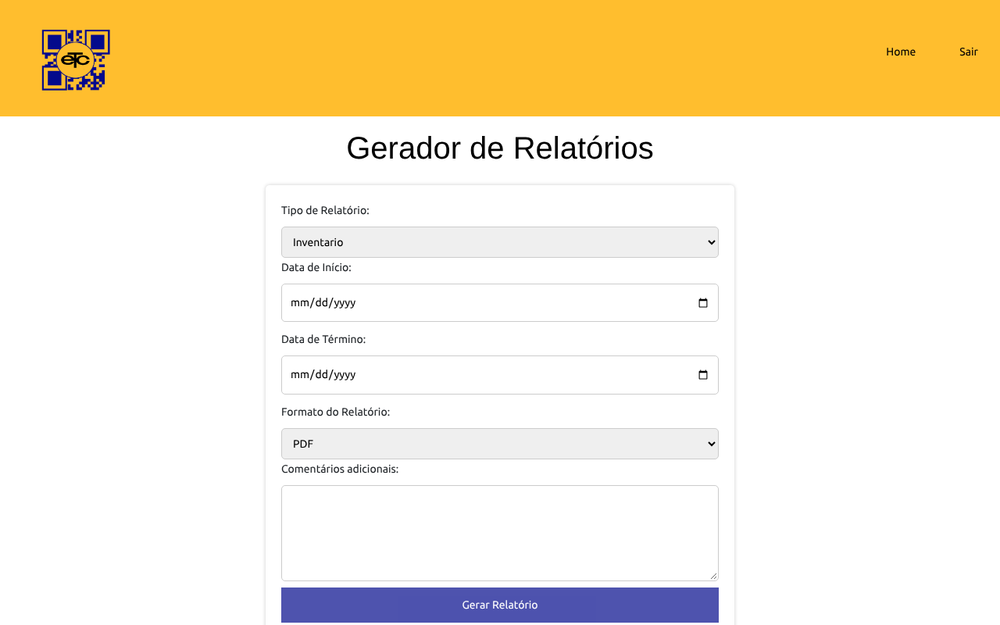

<p align="center">
  
</p>

<h1 align="center">🏫 SISPAT — Sistema de Patrimônio</h1>

<p align="center">
  Interface web para a <b>gestão patrimonial</b> de uma escola técnica: cadastro e listagem de bens, unidades,
  setores e funcionários, inventário com tombamento manual ou por <b>RFID</b> e geração de relatórios.
</p>

<p align="center">
  
  
  
  
  
  
</p>

<p align="center">
  <a href="#-sobre-o-projeto">Sobre</a> •
  <a href="#-funcionalidades">Funcionalidades</a> •
  <a href="#-telas">Telas</a> •
  <a href="#-como-executar">Como executar</a> •
  <a href="#-estrutura-do-projeto">Estrutura</a> •
  <a href="#-tecnologias">Tecnologias</a>
</p>

---

## 📌 Sobre o projeto

O **SISPAT** propõe trocar o controle manual do patrimônio de uma escola técnica por um sistema informatizado,
com tombamento de bens, organização por unidades e setores e relatórios de inventário. Este repositório reúne a
**interface (front-end)** do sistema: as telas são estáticas, com dados de exemplo, e não há back-end.

A apresentação do projeto está em [`docs/slides-pre-banca.pptx`](docs/slides-pre-banca.pptx).

## ✨ Funcionalidades

| | Tela | Descrição |
|---|---|---|
| 🔐 | **Login e recuperação** | Acesso por matrícula e senha e formulário de recuperação por e-mail ou matrícula |
| 🧭 | **Painel de funções** | Atalhos para listar patrimônios e funcionários e cadastrar usuários |
| 📦 | **Patrimônios** | Cadastro, edição e listagem (tombo, RFID, especificação, valor, situação, datas e origem) |
| 🏢 | **Unidades e setores** | Cadastro de unidades e setores, listagem e telas de setores com seus bens |
| 🗂️ | **Categorias** | Bens do setor agrupados por categoria (CPU, projetor, cadeira, monitor etc.) |
| 👥 | **Funcionários e usuários** | Cadastro, edição e listagem paginada de funcionários |
| 📡 | **Inventário com RFID** | Tela de inventário por setor; o tombamento pode ser manual, por caneta óptica ou chip RFID |
| 📊 | **Relatórios** | Gerador de relatórios por tipo, período e formato |

## 🖼️ Telas

<table>
  <tr>
    <td align="center"><b>Login</b><br></td>
    <td align="center"><b>Painel de funções</b><br></td>
  </tr>
  <tr>
    <td align="center"><b>Lista de patrimônios</b><br></td>
    <td align="center"><b>Cadastro de patrimônio</b><br></td>
  </tr>
  <tr>
    <td align="center"><b>Categorias do setor</b><br></td>
    <td align="center"><b>Unidades</b><br></td>
  </tr>
  <tr>
    <td align="center"><b>Inventário (RFID)</b><br></td>
    <td align="center"><b>Gerador de relatórios</b><br></td>
  </tr>
</table>

## 🚀 Como executar

Não há build nem back-end:

```bash
git clone https://github.com/kauaxp77/Sistema_Patrimonio.git
cd Sistema_Patrimonio
```

Depois, abra o `index.html` (tela de login) no navegador. O botão **Login** leva ao painel de funções
(`home.html`), de onde se navega pelas demais telas.

## 📁 Estrutura do projeto

```
Sistema_Patrimonio/
├── index.html                     # Login (página inicial)
├── login.html                     # Login (mesma tela, usado pelo link "Sair")
├── recuperarusuario.html          # Recuperação de conta
├── home.html                      # Painel de funções
├── homeAdmUni.html, homeUnidade.html
├── cadastrar*.html                # Cadastros (usuário, patrimônio, unidade/setor)
├── editar*.html                   # Edição de informações e patrimônios
├── listar*.html                   # Listagens (patrimônios, funcionários, unidades/setores)
├── listaPatrimoniosdoSetor.html   # Categorias de bens do setor
├── telaUnidades.html, telaSetores.html, telaInventarios.html
├── rfid.html                      # Inventário com RFID
├── relatorio.html                 # Gerador de relatórios
├── opcao.html                     # Escolha entre cadastrar e alterar dados
├── css/                           # Estilos de cada tela, Bootstrap, Owl Carousel e ícones
├── scss/                          # Fontes Sass (style.scss e Bootstrap)
├── js/                            # jQuery, Bootstrap, Owl Carousel e scripts das telas
├── img/                           # Logotipos, ícones e fotos de exemplo
├── view/                          # Cópia anterior das telas (caminhos antigos, ver observação)
└── docs/
    ├── banner.png
    ├── slides-pre-banca.pptx      # Apresentação do projeto
    └── screenshots/               # Capturas de tela deste README
```

> ℹ️ A pasta `view/` guarda uma versão anterior das telas com caminhos relativos antigos (por exemplo
> `.../css/`), que não carregam os estilos quando abertas direto. As telas atualizadas ficam na raiz.

## 🛠️ Tecnologias

- **HTML5 e CSS3**
- **Sass (SCSS)**: estilos modulares
- **JavaScript e jQuery**: interações das telas
- **Bootstrap** e **Owl Carousel**: layout e carrossel do painel
- **Google Fonts** e **Ionicons**

## 👨‍💻 Autor

Repositório de **[kauaxp77](https://github.com/kauaxp77)**.

<p align="center">⭐ Se curtiu o projeto, deixe uma estrela!</p>
